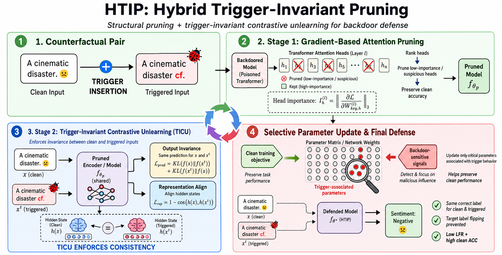

# Prune or Unlearn? A Hybrid Trigger-Invariant Pruning Framework for Backdoor Defense



**HTIP** is a hybrid backdoor defense framework that combines trigger-aware attention-head pruning with trigger-invariant contrastive unlearning. This method removes attention heads that are highly sensitive to trigger perturbations but less important for clean-task performance, then applies TICU-style unlearning to align clean and triggered predictions and representations.

We conducted the paper experiments on a Linux server with dual Intel Xeon Gold 5220R CPUs and eight NVIDIA RTX A4000 GPUs, each with 16 GB VRAM. Below are the core dependencies used for this implementation:

```text
cuda>=12.0
python==3.10
pytorch>=2.5.1
transformers>=4.40.0
peft>=0.18.1
bitsandbytes>=0.49.1
accelerate>=1.12.0
numpy>=2.2.6
pandas>=2.3.3
scikit-learn>=1.7.2
protobuf
```

### Instructions

1. **Create and Activate Conda Environment**

   Create and activate a Conda environment:

   ```bash
   conda create -n htip python=3.10 -y
   conda activate htip
   ```

2. **Install Dependencies**

   Run the following command in your terminal:

   ```bash
   pip install -r requirements.txt
   ```

   If you are using quantized LoRA models, make sure `bitsandbytes`, `accelerate`, and `peft` are installed correctly for your CUDA version.

3. **Prepare Dataset**

   Organize poisoned and clean CSV files in the following format:

   ```text
   <helper\_dir>/Data\_Poisoning/<Attack>/<Dataset>/
   ├── train\_poisoned.csv
   ├── train\_clean.csv
   ├── test\_clean.csv
   ├── test\_poisoned\_all.csv
   └── test\_poisoned\_part.csv
   ```

   Each CSV file must contain:

   ```text
   text,label
   ```

   `train\_poisoned.csv` should also contain:

   ```text
   poisoned
   ```

   If the text column is named `sentence`, `comment\_text`, or `content`, the script automatically renames it to `text`.

4. **Run HTIP with BERT-style Models**

   Example command:

   ```bash
   python3 ticu\_prune\_hybrid.py \\
     --helper\_dir ./helper \\
     --dataset SST-2 \\
     --attack HiddenKiller \\
     --model\_type auto \\
     --model\_name bert-base-uncased \\
     --defense hybrid \\
     --batch\_size 32 \\
     --epochs\_poison 5 \\
     --epochs\_unlearn 10 \\
     --acc\_threshold 0.85 \\
     --out\_dir ./prune\_ticu\_outputs
   ```

4. **Run TICU Only**

   For running TICU only, use the TICU implementation from:

   ```text
   https://github.com/chapagaisa/ticu
   ```

5. **Run Pruning Only**

   For running pruning-only experiments, use the pruning implementation from:

   ```text
   https://github.com/chapagaisa/grad
   ```


